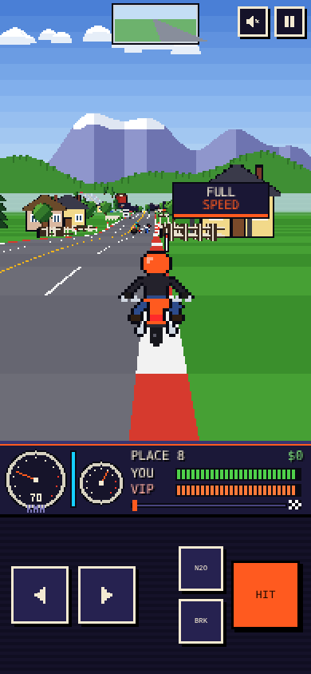
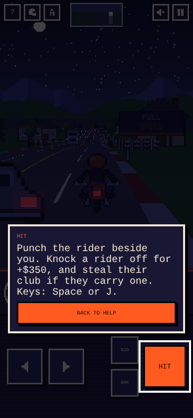
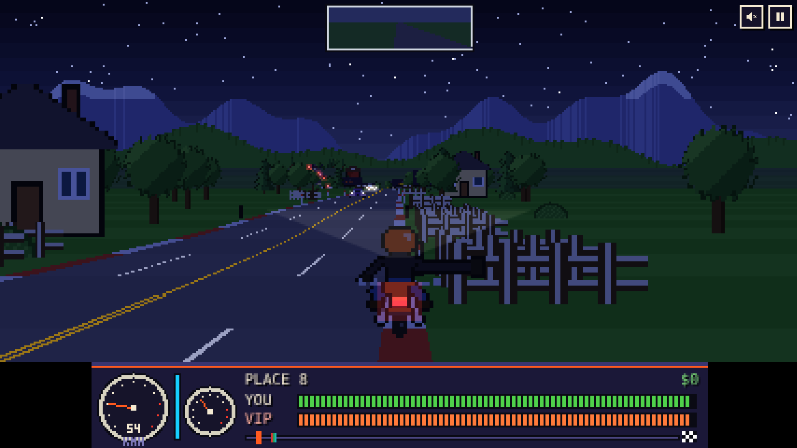

# Road Rush

A 16-bit style motorbike combat racer that runs in the browser and installs as an app (PWA). Race seven rivals down five highways, dodge traffic, and punch anyone who rides too close.

Created by **SSK-BLUM**.

<p align="center">
  
  
</p>
<p align="center">
  
</p>

## App Live

**[▶ Open the live app](https://soorajacontec.github.io/roadrush/)**

## Features

- **Retro pseudo-3D engine**: road drawn line by line in chunky pixels, with rolling hills, curves, banded grass and rumble strips
- **Pixel-art riders and traffic**: riders lean, punch and carry clubs, and crashes throw you over the bars
- **Five roads**: Valley Run, Redwood Pass, Desert Strip, Summit Climb and Coast Highway; finish in the top three to unlock the next
- **Dashboard**: speedometer, rev dial, nitro gauge, place, cash, health bars and a race progress strip, plus a rear-view mirror
- **Day and night modes** with stars, headlight and glowing tail lights
- **Six paint skins** that recolour the bike and the interface
- **Sound**: an original electronic soundtrack generated live, or an MP3 track; plus engine and hit effects
- **How to play guide** with SHOW buttons that highlight the real controls on screen
- **Device layouts**: Auto, Mobile and Tablet, each tuning touch pads, sharpness and view distance
- **Installable and offline-ready** through a web app manifest and service worker
- No build step and no dependencies: one HTML file plus a few assets

## Controls

| Action | Touch | Keyboard |
| --- | --- | --- |
| Steer | ◀ ▶ pads | ← → or A / D |
| Throttle | Automatic (or GAS pad) | ↑ or W |
| Brake | BRK | ↓ or S |
| Punch | HIT | Space or J |
| Nitro | N2O | Shift or K |
| Pause | Pause button | P or Esc |
| Sound on / off | Speaker button | M |
| Help | ? button | ? or H |

## Run it locally

Service workers need a web server, so open the game through a local server rather than by double-clicking the file:

```bash
# from the project folder
python3 -m http.server 8080
# then open http://localhost:8080
```

## App Installation

1. Open Terminal.
2. Download the contents of this folder, or push it:
   ```bash
   git remote add origin https://github.com/soorajacontec/road-rush.git
   git branch -M main
   git push -u origin main
   ```

Note :-  Open that link on your phone and add it to the home screen. iPhone: Share → Add to Home Screen. Android: the **Install app** button on the menu, or the browser menu.

## Music

Electronic mode needs no files. For **Original** mode, add an MP3 named `highway.mp3` to the `music/` folder. See [music/README.md](music/README.md) for a free CC0 track you can use.

## Project structure

```
index.html        game, styles and all code
manifest.json     PWA manifest (name, icons, colours)
sw.js             service worker for offline play
icons/            app icons (192, 512, maskable)
music/            optional highway.mp3 for Original music mode
screenshots/      images used in this README
```

When you change `index.html` after publishing, bump `CACHE` in `sw.js` (for example `road-rush-v4`) so installed copies pick up the new version.

## Credits

- Game, code and pixel art: SSK-BLUM
- Optional track: "Cool Highway [Remake]" by MintoDog, [CC0 public domain](https://opengameart.org/content/cool-highway-remake)
- Fonts: Press Start 2P and VT323 from Google Fonts (SIL Open Font License)

Road Rush is an original fan homage to 16-bit era bike racers. It is not affiliated with or endorsed by Electronic Arts, and it uses no assets from Road Rash.

## License

[MIT](LICENSE) © SSK-BLUM
